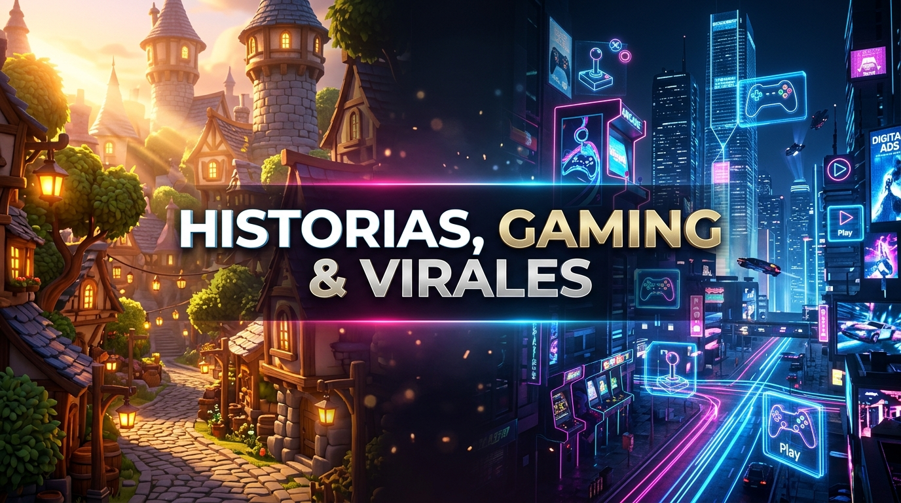

# 🎬 Historias y Momentazos — Suite de Automatización de Contenido Viral con IA

<div align="center">



**Plataforma integral para la creación, edición, subtitulado y publicación automatizada de clips virales de Gaming y micro-novelas animadas con Inteligencia Artificial.**

[](https://python.org)
[](https://fastapi.tiangolo.com)
[](https://www.docker.com/)
[](https://ffmpeg.org/)
[](https://playwright.dev/)

Desarrollado y personalizado por **[Kevin Gaitán](https://github.com/kevingaitan10r)** para el canal **Historias y Momentazos**.

</div>

---

## 🚀 ¿Qué es este proyecto?

**Historias y Momentazos** es un sistema inteligente diseñado para resolver todo el flujo de trabajo de un creador de contenido vertical moderno. En lugar de pasar horas editando manualmente, la plataforma automatiza desde la detección de momentos virales hasta la publicación directa en redes sociales:

1. **Clips Virales de Gaming y Streamers (GTA 6, DjMaRiiO, Willyrex, etc.)**: Analiza videos de YouTube, detecta las partes más emocionantes o divertidas y las convierte en formato vertical 9:16 (1080x1920) con ganchos generados por IA y subtítulos palabra por palabra.
2. **Generador de Novelas Animadas con IA ("Frutinovelas")**: Crea historias originales (drama, comedia y misterio) con personajes 3D animados, voces neuronales y subtítulos karaoke sincronizados.
3. **Publicación Directa**: Conexión con 1 clic para subir los videos directamente a **TikTok** y **YouTube Shorts**.

---

## ✨ Características Principales

### 🧠 1. Detección Neuronal de Momentos Clave (`moments.py`)
* Descarga de videos a máxima resolución mediante `yt-dlp`.
* Transcripción automática de audio local utilizando modelos neuronales (`faster-whisper`).
* Algoritmo de puntuación de momentos por picos de volumen de voz, palabras de hype/asombro y momentos más repetidos.
* **Ganchos y Títulos Atractivos con IA**: Genera títulos de alto CTR analizando el contexto de lo que dicen los streamers con **Google Gemini**.

### 🎨 2. Renderizado Vertical Profesional 9:16 (`cut.py`)
* Salida estándar para Shorts/TikTok/Reels: **1080x1920 a 30/60 fps**.
* Modo de composición inteligente: fondo difuminado en movimiento (*blur layout*) o recorte de cara (*facecam*).
* Subtítulos dinámicos estilo TikTok incrustados en tiempo real con animación palabra por palabra.
* Normalización de audio a -14 LUFS (estándar de plataformas de streaming).

### 🎭 3. Creador de Historias y Novelas IA (`novel_engine.py`)
* Generador de guiones y tramas virales con IA (Traición de Don Plátano, Doña Manzana, Don Aguacate, Don Gato).
* Síntesis de voz neuronal ultrarrealista mediante `edge-tts` en español con múltiples tonos y emociones.
* Animación cinematográfica 3D (movimientos de cámara, zoom dinámico y efectos de transición).

### 📱 4. Panel Web Moderno y Responsivo (`web/`)
* Diseñado con **FastAPI** y **Tailwind CSS**.
* **100% Responsivo**: Se adapta a teléfonos móviles, tablets y ordenadores sin desbordamientos.
* Radar de videos virales en tiempo real de los principales creadores hispanos.
* Reproductor de video interactivo con previsualización vertical.
* Registro de exportación automática a carpeta local en el Escritorio.

### 🌐 5. Subida y Conexión con Redes Sociales
* **TikTok**: Integración con *TikTok Creator Center* mediante Playwright con evasión anti-detección (stealth) y soporte para sesiones persistentes de larga duración.
* **YouTube Shorts**: Conexión OAuth2 oficial de Google con subida automática de título, descripción y etiquetas optimizadas para el algoritmo.

---

## 🛠️ Tecnologías Utilizadas

* **Backend:** Python 3.12, FastAPI, Uvicorn, Pydantic.
* **Procesamiento de Video & Audio:** FFmpeg, FFprobe, OpenCV, Whisper (`faster-whisper` / `CTranslate2`).
* **Inteligencia Artificial:** Google Gemini API (`google-genai`), Microsoft Edge TTS.
* **Automatización Web:** Playwright (Chromium con perfiles de evasión stealth).
* **Frontend:** HTML5, Tailwind CSS, JavaScript Vanilla, FontAwesome Icons.
* **Contenedorización:** Docker, Dockerfile optimizado para Debian/Ubuntu.

---

## 💻 Instalación y Uso Local

### 1. Clonar el repositorio
```bash
git clone https://github.com/kevingaitan10r/historias-y-momentazos.git
cd historias-y-momentazos
```

### 2. Crear entorno virtual e instalar dependencias
```bash
python3 -m venv .venv
source .venv/bin/activate
pip install -r requirements.txt
playwright install chromium
```

### 3. Iniciar el Panel Web
```bash
uvicorn web.app:app --host 127.0.0.1 --port 8000 --reload
```
Abre en tu navegador: **`http://localhost:8000`**

---

## 🐳 Despliegue en la Nube (Docker / Railway / VPS)

El proyecto incluye un `Dockerfile` listo para correr en cualquier servidor Linux o servicio PaaS (Railway, Render, Hetzner, etc.):

```bash
docker build -t historias-y-momentazos .
docker run -p 8000:8000 historias-y-momentazos
```

---

## 👤 Creador
* **Kevin Gaitán** - [@kevingaitan10r](https://github.com/kevingaitan10r)
* Canal Oficial: **Historias y Momentazos** (TikTok & YouTube Shorts)

---
<sub>Proyecto desarrollado para experimentación y producción de contenido automatizado con Inteligencia Artificial.</sub>
